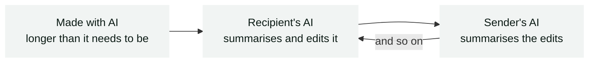
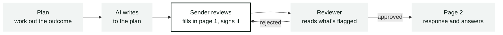
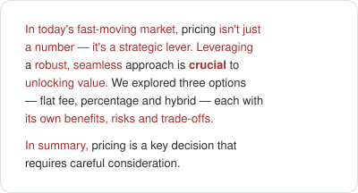
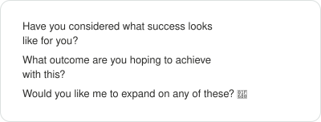
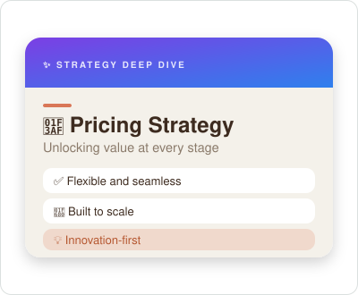

# Antislopification: a framework to reduce workplace slop

AI is a fantastic tool. It's incredibly powerful, but at the end of the day it's still a tool, and it's become a double-edged sword. Documents and walls of text are incredibly easy to generate with very little human input. They take hours to review, so AI gets used to review them, and then there's no real human input anywhere.

This is what usually happens (visualised below):

- A document gets created with AI, and it's often far longer than it needs to be.
- The recipient gets it, can't be bothered reading it, and asks AI to summarise and edit it.
- They send it back to the original person, who can't be bothered reading all that either, so they get AI to summarise the edits.
- And so on.

The useful part is in there somewhere, but it takes far longer than it should to get to it, and filtering through all of it to find it is mentally draining.

AI should be used to accelerate work, without a doubt, but only after careful consideration of its output. It should be 90% planning (a conversation between people and AI) before any document is created. AI is fantastic at completing something to a goal you define. If you don't ask yourself what the outcome of the work should be, AI will connect the dots for you, and that's where unknowns, verbosity and plain wasted time creep in, even with frontier models.

This is a light framework to encourage using AI within teams while keeping critical human thinking. It comes down to one form, the Handoff, that the sender fills in before a document goes to anyone.

## How it works

Plan, plan, plan. If the planning is done properly, nothing AI writes should surprise you. If you can't point to what you've just done, or explain it, you've just created slop.

Step by step (visualised below):

- Plan it. Work out exactly what you're trying to achieve, with people and with AI.
- Get AI to write it to that plan.
- Review it yourself.
- Fill in page 1 of the [Handoff](handoff.pdf): the outcome, what you need from them, up to three questions, where the document is, how long it takes to read and what to read. Then sign it.
- Send the document with the Handoff.
- The reviewer reads what they've been pointed to. If it's approved, they fill in page 2: their response and an answer to each question, which carry over from page 1. If it's rejected, they fill in page 3 with why.
- If it's rejected, it goes back to the sender.

## Rules

1. Scope the work so three questions or fewer are enough. If you need feedback on more than that, split it into stages and send each one for review separately. Otherwise it's slop.
2. Cap the reading, not the document. A long document is fine if the reviewer only needs a couple of pages of it. If it takes more than 15 minutes to read, say why.
3. Sign it. You've read all of it and you stand behind it.
4. Answer in your own words, not with a pasted AI reply.
5. The reviewer can reject it if they think it needs changes, or if slop has crept in.

## When to use it

Documents, and anything long enough to be one. If a message needs scrolling or headings, treat it as a document. Quick questions, updates and normal chat don't need it.

## Signs of slop

Check your document for these before you send it. A telltale sign is a section you never asked for and have no idea why it exists.

### Writing

- The same point made three ways
- Filler at the start and end: "In today's fast-moving landscape…", "I hope this helps!"
- A summary of what you just read: "In summary", "Key takeaways"
- Stock words: leverage, robust, seamless, crucial, delve, unlock, moat
- "Not just X, but Y"
- Everything in threes
- Bold scattered mid-sentence
- Em dashes everywhere
- Sounding like a LinkedIn warrior
- "It's not this… it's that…"

### Questions

- Open-ended questions meant for whoever prepared the document, copied straight from the chat: "Have you considered what success looks like for you?", "What outcome are you hoping to achieve with this?"
- Offers left over from the chat: "Would you like me to expand on any of these?"

### Visuals

 

- Harsh gradients, purple into blue
- The little line above the heading
- Small label, big title, slightly bigger subtitle
- Terracotta and beige
- Emoji as bullet points
- An icon next to every heading, or in a circle on every row
- Everything in a rounded card with a shadow
- Every fact in a pill or badge
- A colour per section that doesn't mean anything
- Fragments joined with dots: "Live · Stable · Scaling"
- Big number, small label: "3x faster onboarding"
- A table dressed up as cards

